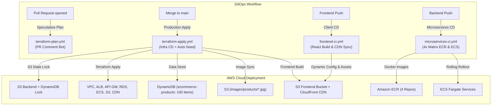
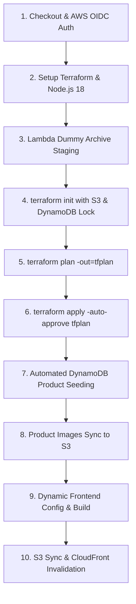

# GitHub Actions CI/CD Complete Guide: AWS eCommerce Platform

Welcome to your production-grade GitHub Actions CI/CD setup! This guide explains how every pipeline works under the hood, how AWS OpenID Connect (OIDC) authenticates without static passwords, and the step-by-step instructions for continuous integration (CI) and continuous deployment (CD).

---

## 1. Core Architecture: The Mental Model

GitHub Actions is an **event-driven GitOps automation engine** hosted directly within GitHub that provisions, tests, and deploys code into AWS.



### Key Terminology
1. **Workflow**: An automated configurable procedure defined in a `.yml` file under `.github/workflows/`.
2. **Event (`on:`)**: The trigger that tells GitHub when to run the workflow (`push`, `pull_request`, `workflow_dispatch`).
3. **Path Filtering (`paths:`)**: Ensures workflows only execute when relevant code changes. For example, editing frontend CSS won't waste runner minutes rebuilding backend Docker containers or running Terraform.
4. **Runner (`runs-on: ubuntu-latest`)**: A clean, isolated Virtual Machine in GitHub's cloud.
5. **Permissions (`permissions:`)**: Controls token capabilities. We set `id-token: write` so GitHub can issue cryptographically signed JWT tokens for AWS OIDC.
6. **Concurrency (`concurrency:`)**: Prevents race conditions. For Terraform, `concurrency: terraform-production-apply` ensures apply operations queue sequentially and never clash on state locks.

---

## 2. Zero-Secret AWS OIDC Authentication

Traditional CI/CD required storing static AWS IAM Access Keys (`AKIA...` and Secret Key) in GitHub Secrets.

> [!WARNING]
> **Risks of Static AWS Keys:**
> - Static keys never expire unless manually rotated.
> - If accidentally leaked in logs or public commits, attackers gain full access to your AWS account.
> - Difficult to audit which specific commit or pipeline used which key.

### The Modern Standard: AWS OpenID Connect (OIDC)
Our setup uses **Zero-Secret OIDC**:
```
GitHub Actions Runner                      AWS IAM / STS
       |                                          |
       | 1. Generates signed JWT token            |
       |----------------------------------------->|
       |                                          | 2. Validates:
       |                                          |    - Issuer: token.actions.githubusercontent.com
       |                                          |    - Audience: sts.amazonaws.com
       |                                          |    - Subject: repo:mohsen2181/terraform-aws-projets:*
       |                                          |
       | 3. Returns temporary 15-min credentials |
       |<-----------------------------------------|
       |                                          |
(Uses temp credentials for Terraform / S3 / ECR / ECS commands)
```

No AWS access keys or passwords are stored anywhere in GitHub Secrets.

---

## 3. Workflow Breakdown & Detailed CD Steps

The repository contains **5 specialized workflows** covering both CI (Continuous Integration) and CD (Continuous Deployment):

| Workflow File | Type | Trigger | Purpose |
| :--- | :---: | :--- | :--- |
| **`terraform-ci.yml`** | CI | PR / Push to `modules/**` | Formatting checks, dynamic Lambda packaging, `terraform validate` |
| **`terraform-plan.yml`** | CI | PR to `main` | Speculative plan generation and automated PR commenting |
| **`terraform-apply.yml`** | CD | Merge to `main` (infra paths) | State locking, infrastructure apply, DynamoDB catalog seeding, image sync, frontend deploy |
| **`frontend-ci.yml`** | CD | Merge to `main` (frontend paths) | Dynamic config injection, React build, S3 sync, image preservation, CloudFront purge |
| **`microservices-ci.yml`** | CD | Merge to `main` (backend paths) | 4-way parallel Docker container builds, ECR push, ECS rolling deployment |

---

### 🟢 1. Terraform CI (`terraform-ci.yml`)
- **Trigger**: Changes inside `terraform-ecommerce/environments/**` or `terraform-ecommerce/modules/**`.
- **Purpose**: Fast feedback loop ensuring Terraform code is properly formatted and syntactically valid before PR review.
- **Detailed Steps**:
  1. `actions/checkout@v4`: Clones repository code to the runner.
  2. `hashicorp/setup-terraform@v3`: Installs Terraform `1.8.5`.
  3. `terraform fmt -check -recursive`: Fails if code does not adhere to canonical formatting.
  4. **Dynamic Lambda Zip Packaging**: Generates a dummy `order_processor.zip` handler so that Terraform's `filebase64sha256()` check succeeds without storing binary archives in git.
  5. `terraform init -backend=false`: Initializes providers without requiring remote state backend access.
  6. `terraform validate`: Validates all module arguments, variable types, and resource syntax.

---

### 🟡 2. Speculative Terraform Plan (`terraform-plan.yml`)
- **Trigger**: Pull Requests opened or updated against `main` affecting Terraform files.
- **Purpose**: Provides visibility into exact infrastructure changes before code is merged.
- **Detailed Steps**:
  1. Authenticates to AWS via OIDC assuming role `github-actions-ecommerce-role`.
  2. Initializes Terraform with remote S3 backend:
     `s3://ecommerce-tfstate-727742746869/dev/terraform.tfstate`
  3. Runs `terraform plan -no-color` to compute the execution diff.
  4. Formats the plan into an organized GitHub markdown comment.
  5. Uses `actions/github-script@v7` to find existing bot comments on the PR and update them in-place with the latest plan summary.

---

### 🚀 3. Terraform Production Apply CD (`terraform-apply.yml`)
- **Trigger**: Merges to `main` affecting `environments/**`, `modules/**`, or manual `workflow_dispatch`.
- **Purpose**: Automatically applies infrastructure changes, seeds baseline database records, synchronizes assets, and brings the storefront live.
- **Concurrency Guard**:
  ```yaml
  concurrency:
    group: terraform-production-apply
    cancel-in-progress: false
  ```
  Queues executions so that multiple merges never conflict on the DynamoDB state lock.

#### Detailed CD Steps:


1. **OIDC Authentication**: Authenticates with AWS using the dedicated GitHub Actions IAM role.
2. **Toolchain Setup**: Installs Terraform `1.8.5` and Node.js `18`.
3. **Lambda Packaging**: Staged archive generation for `order_processor.zip`.
4. **Terraform Init & State Lock**:
   Connects to remote S3 state bucket `ecommerce-tfstate-727742746869` and acquires the distributed lock from DynamoDB table `ecommerce-tflocks`.
5. **Terraform Plan**: Generates compiled execution plan `tfplan`.
6. **Terraform Apply**: Runs `terraform apply -auto-approve tfplan` with zero interactive prompts.
7. **Automated DynamoDB Product Seeding**:
   - Queries table `ecommerce-products`:
     `aws dynamodb scan --table-name ecommerce-products --select "COUNT"`
   - If empty (`COUNT == 0`), runs `load-products.sh` to populate all 100 products from `products.json` with categories, prices, stock levels, and CDN image URLs.
   - If products already exist, skips seeding automatically to preserve live data.
8. **Product Images Synchronization**:
   - Synchronizes `terraform-ecommerce/data/product-images/` to `s3://ecommerce-frontend-727742746869/images/products/` with `--content-type "image/jpeg"`.
9. **Dynamic Frontend Configuration & Build**:
   - Executes `configure-frontend.sh` to extract the fresh API Gateway base URL and Cognito User Pool ID from Terraform outputs.
   - Updates `aws-config.js` with the active endpoints.
   - Installs dependencies (`npm ci`) and builds the React production bundle (`CI=false npm run build`).
10. **Storefront Sync & CloudFront CDN Invalidation**:
    - Syncs the React build directory to `s3://ecommerce-frontend-727742746869/`.
    - Automatically discovers the CloudFront distribution ID.
    - Issues `aws cloudfront create-invalidation --paths "/*"` so edge locations worldwide immediately serve the latest storefront and catalog.

---

### 🟣 4. Frontend Application CD (`frontend-ci.yml`)
- **Trigger**: Changes inside `terraform-ecommerce/frontend/**` or `terraform-ecommerce/data/product-images/**`.
- **Purpose**: Independent, rapid client-side CI/CD pipeline for React web development.

#### Detailed CD Steps:
1. **Dependency Installation**: Runs `npm ci` with GitHub npm cache enabled.
2. **Dynamic Endpoint Injection**: Executes `configure-frontend.sh` to query live Terraform outputs or AWS SSM/Cognito/API Gateway fallback values before compilation.
3. **Optimized Production Build**: Runs `npm run build` with `CI: false` to generate production HTML, JS, CSS, and media chunks.
4. **S3 Static Asset Sync**: Syncs `build/` to `s3://ecommerce-frontend-727742746869/`.
5. **Catalog Image Preservation**: Synchronizes `terraform-ecommerce/data/product-images/` to `s3://ecommerce-frontend-727742746869/images/products/`, ensuring UI updates never delete catalog image assets.
6. **CloudFront Cache Purge**: Discovers distribution `E1A891VBTZ3J0M` and submits invalidation for `/*`.

---

### 🔵 5. Microservices CD (`microservices-ci.yml`)
- **Trigger**: Changes inside `terraform-ecommerce/backend/**`.
- **Purpose**: Builds Docker images for all 4 microservices simultaneously, pushes them to Amazon ECR, and triggers zero-downtime rolling replacement in ECS Fargate.

#### Detailed CD Steps:
1. **Parallel Matrix Strategy**:
   GitHub spins up 4 runner VMs in parallel using `strategy.matrix`:
   - `product-service` $\to$ ECR repository `ecommerce/product-service`
   - `cart-service` $\to$ ECR repository `ecommerce/cart-service`
   - `user-service` $\to$ ECR repository `ecommerce/user-service`
   - `order-service` $\to$ ECR repository `ecommerce/order-service`
2. **ECR Login**: Runs `aws-actions/amazon-ecr-login@v2` to authenticate runner Docker daemon to private AWS ECR.
3. **Docker Multi-Tagging & Build**: Builds containers with two tags:
   - `:latest`: For current active deployment.
   - `:${{ github.sha }}`: Full git commit traceability.
4. **Image Push**: Pushes multi-tagged images to Amazon ECR.
5. **Zero-Downtime ECS Rolling Rollout**:
   Runs `aws ecs update-service --cluster ecommerce-cluster --service ecommerce-<service> --force-new-deployment` to replace existing Fargate tasks with zero downtime.

---

## 4. Execution Order & Pipeline Dependencies

```
Initial Deployment:
  1. terraform-apply.yml  ──► Provisions AWS Cloud, Seeds DynamoDB, Syncs Images, Deploys Frontend
  2. microservices-ci.yml ──► Builds 4 Docker Images, Pushes to ECR, Deploys ECS Fargate Services

Day-to-Day Maintenance (Isolated & Fast):
  • Frontend edit    ──► Triggers ONLY frontend-ci.yml (~1m 15s)
  • Microservice edit ──► Triggers ONLY microservices-ci.yml (~2m)
  • Terraform edit   ──► PR triggers terraform-plan.yml, Merge triggers terraform-apply.yml
```

---

## 5. How to Run and Test Workflows

### Method A: Automated via Git Push (Standard Development)
```bash
# 1. On your Vagrant VM:
cd /home/vagrant/terraform-projects/terraform-aws-projets

# 2. Make an edit to the frontend, backend, or terraform
echo "// deploy test $(date)" >> terraform-ecommerce/frontend/react-app/src/index.js

# 3. Commit and push:
git add terraform-ecommerce/frontend/react-app/src/index.js
git commit -m "feat: updated frontend components"
git push origin main
```
*Result: Only the corresponding workflow runs automatically.*

### Method B: Manual Trigger via GitHub UI (`workflow_dispatch`)
1. Navigate to: 👉 **`https://github.com/mohsen2181/terraform-aws-projets/actions`**
2. In the left sidebar, click the target workflow (e.g. **"Terraform Apply (Production Deploy)"**).
3. Click the **"Run workflow"** button on the right side.
4. Select **Branch: main** and click **Run workflow**.

---

## 6. How to Monitor Logs & Troubleshoot

1. Go to the **Actions** tab on GitHub:
   `https://github.com/mohsen2181/terraform-aws-projets/actions`
2. Click any workflow run.
3. Click on the job box (e.g., *Apply Infrastructure to AWS*).
4. Live output streams in real time. Expand any step to view CLI outputs:
   - Step 9: `Terraform Apply` stdout/stderr.
   - Step 10: DynamoDB catalog count and seeding logs.
   - Step 11: S3 image sync progress.
   - Step 12: `aws-config.js` configuration and CloudFront invalidation ID.

---

## 7. Verified Production Endpoints

| Resource | Live Endpoint / Value |
| :--- | :--- |
| **Storefront (CloudFront CDN)** | **[https://mycloudhomelab.click](https://mycloudhomelab.click)** |
| **API Gateway (HTTP v2)** | `https://rylu5a92dd.execute-api.us-east-1.amazonaws.com` |
| **Catalog API** | `https://rylu5a92dd.execute-api.us-east-1.amazonaws.com/products` (100 products) |
| **Product Images** | `https://mycloudhomelab.click/images/products/prod-001.jpg` (HTTP 200 OK) |
| **S3 Remote State** | `s3://ecommerce-tfstate-727742746869/dev/terraform.tfstate` |
| **DynamoDB State Lock** | `ecommerce-tflocks` |
| **GitHub Actions IAM Role** | `arn:aws:iam::727742746869:role/github-actions-ecommerce-role` |
