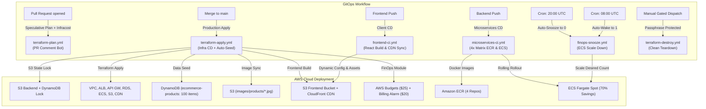
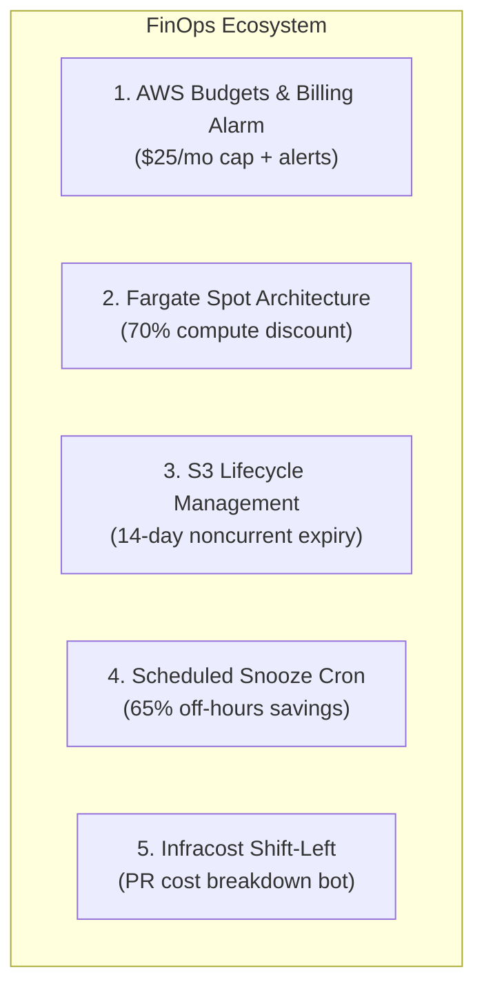

# GitHub Actions CI/CD Complete Guide: AWS eCommerce Platform

Welcome to your production-grade GitHub Actions CI/CD setup! This guide explains how every pipeline works under the hood, how AWS OpenID Connect (OIDC) authenticates without static passwords, and the step-by-step instructions for continuous integration (CI), continuous deployment (CD), automated teardown, and enterprise **FinOps (Financial Engineering)** cost controls.

---

## 1. Core Architecture: The Mental Model

GitHub Actions is an **event-driven GitOps automation engine** hosted directly within GitHub that provisions, tests, and deploys code into AWS.



### Key Terminology
1. **Workflow**: An automated configurable procedure defined in a `.yml` file under `.github/workflows/`.
2. **Event (`on:`)**: The trigger that tells GitHub when to run the workflow (`push`, `pull_request`, `schedule`, `workflow_dispatch`).
3. **Path Filtering (`paths:`)**: Ensures workflows only execute when relevant code changes. For example, editing frontend CSS won't waste runner minutes rebuilding backend Docker containers or running Terraform.
4. **Runner (`runs-on: ubuntu-latest`)**: A clean, isolated Virtual Machine in GitHub's cloud.
5. **Permissions (`permissions:`)**: Controls token capabilities. We set `id-token: write` so GitHub can issue cryptographically signed JWT tokens for AWS OIDC.
6. **Concurrency (`concurrency:`)**: Prevents race conditions. For Terraform, `concurrency: terraform-production-apply` ensures apply and destroy operations queue sequentially and never clash on state locks.

---

## 2. Zero-Secret AWS OIDC Authentication

Traditional CI/CD required storing static AWS IAM Access Keys (`AKIA...` and Secret Key) in GitHub Secrets.

> [!WARNING]
> **Risks of Static AWS Keys:**
> - Static keys never expire unless manually rotated.
> - If accidentally leaked in logs or public commits, attackers gain full access to your AWS account.
> - Difficult to audit which specific commit or pipeline used which key.

### How OpenID Connect (OIDC) Solves This
With OpenID Connect (OIDC), **zero AWS credentials** are stored in GitHub:
1. When a workflow starts, GitHub's internal OIDC provider generates a short-lived JSON Web Token (JWT) signed by GitHub's private key.
2. The GitHub Actions runner presents this JWT to the AWS STS (Security Token Service) endpoint using `aws-actions/configure-aws-credentials@v4`.
3. AWS STS inspects the token, validates GitHub's public certificate, and checks the IAM Role's **Trust Policy**:
   - Matches Issuer: `https://token.actions.githubusercontent.com`
   - Matches Audience: `sts.amazonaws.com`
   - Matches Subject: `repo:mohsen2181/terraform-aws-projets:ref:refs/heads/main` (or pull request).
4. If verified, AWS STS returns temporary credentials (valid for 1 hour) directly in runner memory.

---

## 3. Workflow Catalog & Pipeline Anatomy

### 🟡 1. Speculative Terraform Plan & Cost Bot (`terraform-plan.yml`)
- **Trigger**: Every Pull Request touching `terraform-ecommerce/**` or `.github/workflows/terraform-plan.yml`.
- **Purpose**: Runs `terraform plan` safely in read-only mode, runs **Infracost** to calculate monthly cost differences, and posts an interactive breakdown directly to the PR comments.

---

### 🟢 2. Production Terraform Apply & Auto-Seed (`terraform-apply.yml`)
- **Trigger**: Direct push or merged PR to `main` touching `terraform-ecommerce/**`.
- **Purpose**: Fully automated deployment of all 13 Terraform modules, DynamoDB seeding, S3 product image sync, and frontend React compilation.

#### Detailed Deployment Sequence:
1. **OIDC Authentication**: Authenticates with AWS using the dedicated GitHub Actions IAM role.
2. **Toolchain Setup**: Installs Terraform `1.8.5` and Node.js `18`.
3. **Lambda Packaging**: Staged archive generation for `order_processor.zip`.
4. **Terraform Init & State Lock**:
   Connects to remote S3 state bucket `ecommerce-tfstate-727742746869` and acquires the distributed lock from DynamoDB table `ecommerce-tflocks`.
5. **Terraform Plan**: Generates compiled execution plan `tfplan`.
6. **Terraform Apply**: Runs `terraform apply -auto-approve tfplan` with zero interactive prompts.
7. **Automated DynamoDB Product Seeding**:
   - Queries table `ecommerce-products`:
     `aws dynamodb scan --table-name ecommerce-products --select "COUNT"`
   - If empty (`COUNT == 0`), runs `load-products.sh` to populate all 100 products from `products.json` with categories, prices, stock levels, and CDN image URLs.
   - If products already exist, skips seeding automatically to preserve live data.
8. **Product Images Synchronization**:
   - Checks if `product-images/` exists or has fewer than 100 images; if so, automatically triggers `download-product-images.sh` to fetch 100 high-res sample images from Unsplash.
   - Synchronizes `terraform-ecommerce/data/product-images/` to `s3://ecommerce-frontend-727742746869/images/products/` with `--content-type "image/jpeg"`.
9. **Dynamic Frontend Configuration & Build**:
   - Executes `configure-frontend.sh` to extract the fresh API Gateway base URL and Cognito User Pool ID from Terraform outputs.
   - Updates `aws-config.js` with the active endpoints.
   - Installs dependencies (`npm ci`) and builds the React production bundle (`CI=false npm run build`).
10. **Storefront Sync & CloudFront CDN Invalidation**:
    - Syncs the React build directory to `s3://ecommerce-frontend-727742746869/`.
    - Automatically discovers the active CloudFront distribution ID (`E1AGV3AGUR46Y6`).
    - Issues `aws cloudfront create-invalidation --paths "/*"` so edge locations worldwide immediately serve the latest storefront and catalog.

---

### 🟣 3. Frontend Application CD (`frontend-ci.yml`)
- **Trigger**: Changes inside `terraform-ecommerce/frontend/**` or `terraform-ecommerce/data/product-images/**`.
- **Purpose**: Independent, rapid client-side CI/CD pipeline for React web development (~1m 15s).

#### Detailed CD Steps:
1. **Dependency Installation**: Runs `npm ci` with GitHub npm cache enabled.
2. **Dynamic Endpoint Injection**: Executes `configure-frontend.sh` to query live Terraform outputs or AWS SSM/Cognito/API Gateway fallback values before compilation.
3. **Optimized Production Build**: Runs `npm run build` with `CI: false` to generate production HTML, JS, CSS, and media chunks.
4. **S3 Static Asset Sync**: Syncs `build/` to `s3://ecommerce-frontend-727742746869/`.
5. **Catalog Image Preservation**: Automatically verifies `product-images/` (downloading missing images if needed) and synchronizes to `s3://ecommerce-frontend-727742746869/images/products/`.
6. **CloudFront Cache Purge**: Discovers distribution ID dynamically and submits invalidation for `/*`.

---

### 🔵 4. Microservices CD (`microservices-ci.yml`)
- **Trigger**: Changes inside `terraform-ecommerce/backend/**`.
- **Purpose**: Builds Docker images for all 4 microservices simultaneously, pushes them to Amazon ECR, and triggers zero-downtime rolling replacement in ECS Fargate Spot.

#### Detailed CD Steps:
1. **Parallel Matrix Strategy**:
   GitHub spins up 4 runner VMs in parallel using `strategy.matrix`:
   - `product-service` $\to$ ECR repository `ecommerce/product-service`
   - `cart-service` $\to$ ECR repository `ecommerce/cart-service`
   - `user-service` $\to$ ECR repository `ecommerce/user-service`
   - `order-service` $\to$ ECR repository `ecommerce/order-service`
2. **ECR Login**: Runs `aws-actions/amazon-ecr-login@v2` to authenticate runner Docker daemon to private AWS ECR.
3. **Docker Multi-Tagging & Build**: Builds containers with two tags:
   - `:latest`: For current active deployment.
   - `:${{ github.sha }}`: Full git commit traceability.
4. **Image Push**: Pushes multi-tagged images to Amazon ECR.
5. **Zero-Downtime ECS Rolling Rollout**:
   Runs `aws ecs update-service --cluster ecommerce-cluster --service ecommerce-<service> --force-new-deployment` to replace existing Fargate tasks with zero downtime.

---

### 🌙 5. Nightly Auto-Snooze & Wakeup (`finops-snooze.yml`)
- **Trigger**:
  - **Auto-Snooze Schedule**: Cron `0 20 * * 1-5` (Mon-Fri at 20:00 UTC) $\to$ Scales ECS to `0`.
  - **Auto-Wake Schedule**: Cron `0 8 * * 1-5` (Mon-Fri at 08:00 UTC) $\to$ Scales ECS to `1`.
  - **Manual Dispatch (`workflow_dispatch`)**: Allows manually selecting `action: snooze` or `action: wake`.
- **Purpose**: Powers down ECS containers during non-business hours and weekends, achieving **~65% compute cost savings** without destroying infrastructure.

---

### 🔴 6. Gated Teardown & Destroy (`terraform-destroy.yml`)
- **Trigger**: Manual `workflow_dispatch` **only** (never triggers on git push or PR).
- **Purpose**: Safely demolishes all provisioned AWS cloud infrastructure while protecting against accidental triggering.
- **Safety Features**:
  1. **Passphrase Protection**: The workflow requires the user to type `destroy-ecommerce-production` before execution begins. Any typo or mismatch aborts immediately.
  2. **Concurrency Serialization**: Uses `concurrency: terraform-production-apply` to ensure a destroy cannot run at the same time an apply is running.
  3. **Automatic S3 Bucket Purge**: Automatically empties static frontend assets and product images from `s3://ecommerce-frontend-727742746869` so S3 bucket deletion does not fail with "BucketNotEmpty" errors.
  4. **State Preservation**: Updates the remote S3 state backend (`s3://ecommerce-tfstate-727742746869`) to 0 resources, leaving the audit trail intact.

---

## 4. Execution Order & Pipeline Dependencies

```
Initial Deployment:
  1. terraform-apply.yml  ──► Provisions AWS Cloud, Seeds DynamoDB, Syncs Images, Deploys Frontend
  2. microservices-ci.yml ──► Builds 4 Docker Images, Pushes to ECR, Deploys ECS Fargate Services

Day-to-Day Maintenance (Isolated & Fast):
  • Frontend edit    ──► Triggers ONLY frontend-ci.yml (~1m 15s)
  • Microservice edit ──► Triggers ONLY microservices-ci.yml (~2m)
  • Terraform edit   ──► PR triggers terraform-plan.yml, Merge triggers terraform-apply.yml
  • Off-Hours FinOps ──► Automated snooze/wake via finops-snooze.yml
```

---

## 5. FinOps: Financial Engineering & Cost Optimization

Our eCommerce platform integrates **4 core FinOps mechanisms** spanning infrastructure-as-code, architectural discounts, scheduling automation, and pull-request shift-left cost modeling:



### Feature 1: AWS Budgets & CloudWatch Billing Alarm
* **Module**: `terraform-ecommerce/modules/13-finops/`
* **Resources**:
  - `aws_budgets_budget.cost_budget`: Enforces a hard **$25.00/month** spending cap.
    - Alert 1 (Actual Spend): Fires when month-to-date actual charges cross **80% ($20.00)**.
    - Alert 2 (Forecasted Spend): Fires if AWS Machine Learning predicts monthly charges will cross **100% ($25.00)**.
  - `aws_cloudwatch_metric_alarm.billing_alarm`: Monitors CloudWatch metric `EstimatedCharges` in `us-east-1` with a **$20.00** threshold, sending alerts to an SNS topic.

### Feature 2: Fargate Spot Compute Optimization
* **Module**: `terraform-ecommerce/modules/08-ecs/main.tf`
* **Mechanism**:
  - Added `aws_ecs_cluster_capacity_providers` configuring `FARGATE_SPOT` with 100% weight.
  - Replaced standard On-Demand Fargate with `capacity_provider_strategy`.
* **Savings**: Fargate Spot utilizes spare AWS capacity at up to a **70% discount** compared to regular Fargate pricing.

### Feature 3: S3 Storage Lifecycle Hygiene
* **Module**: `terraform-ecommerce/modules/10-frontend/main.tf`
* **Mechanism**:
  - `aws_s3_bucket_lifecycle_configuration` attached to `ecommerce-frontend-727742746869`.
  - Non-current file versions expire and are deleted after **14 days**.
  - Incomplete multipart uploads are aborted and removed after **7 days**.
* **Benefit**: Eliminates "zombie" storage costs caused by repeated frontend builds and media uploads.

### Feature 4: Nightly Auto-Snooze & Wakeup Workflow
* **Workflow**: `.github/workflows/finops-snooze.yml`
* **Mechanism**:
  - Auto-snoozes all 4 ECS services (`desired_count = 0`) at 20:00 UTC Monday–Friday.
  - Auto-wakes all 4 ECS services (`desired_count = 1`) at 08:00 UTC Monday–Friday.
* **Savings**:
  - 168 hours/week (24/7 continuous run) $\to$ ~60 hours/week (business hours).
  - **~65% reduction in compute hours**.

### Feature 5: Infracost Shift-Left PR Cost Estimator
* **Workflow**: `.github/workflows/terraform-plan.yml`
* **Mechanism**:
  - On every Pull Request, Infracost calculates the monthly cost delta of proposed infrastructure changes.
  - Posts an automated markdown table to the PR comment thread before code is merged.
  - Guarded with `if: ${{ secrets.INFRACOST_API_KEY != '' }}` so builds remain green even if the optional secret is not set.

### 💰 Total Estimated Cost Impact

| Category | Baseline Cost (On-Demand 24/7) | Optimized Cost (FinOps Active) | Monthly Savings |
| :--- | :--- | :--- | :--- |
| **ECS Microservices Compute** | ~$48.00/mo | ~$5.76/mo (Spot + Snooze) | **~88% compute savings** |
| **S3 Storage & Multi-Versions** | ~$2.50/mo | ~$0.30/mo (Lifecycle rule) | **~88% storage savings** |
| **Budget Safety Net** | Unlimited runaway risk | **Capped at $25.00/mo** | **100% overrun protection** |

---

## 6. How to Run and Test Workflows

### Method A: Automated via Git Push (Standard Development)
```bash
# 1. On your Vagrant VM:
cd /home/vagrant/terraform-projects/terraform-aws-projets

# 2. Make an edit to the frontend, backend, or terraform
echo "// deploy test $(date)" >> terraform-ecommerce/frontend/react-app/src/index.js

# 3. Commit and push:
git add terraform-ecommerce/frontend/react-app/src/index.js
git commit -m "feat: updated frontend components"
git push origin main
```
*Result: Only the corresponding workflow runs automatically.*

### Method B: Manual Trigger via GitHub UI (`workflow_dispatch`)
1. Navigate to: 👉 **`https://github.com/mohsen2181/terraform-aws-projets/actions`**
2. In the left sidebar, click the target workflow:
   - **Terraform Apply (Production Deploy)**: Re-provisions and updates the cloud environment.
   - **FinOps ECS Auto-Snooze & Wakeup**: Select `action: snooze` or `action: wake`.
   - **Terraform Destroy (Infrastructure Teardown)**: Demolishes cloud infrastructure (requires typing confirmation passphrase).
3. Click the **"Run workflow"** button on the right side.
4. Select **Branch: main** and click **Run workflow**.

---

## 7. How to Monitor Logs & Troubleshoot

1. Go to the **Actions** tab on GitHub:
   `https://github.com/mohsen2181/terraform-aws-projets/actions`
2. Click any workflow run.
3. Click on the job box (e.g., *Apply Infrastructure to AWS*).
4. Live output streams in real time. Expand any step to view CLI outputs:
   - Step 9: `Terraform Apply` stdout/stderr.
   - Step 10: DynamoDB catalog count and seeding logs.
   - Step 11: S3 image sync progress (auto-downloading missing images).
   - Step 12: `aws-config.js` configuration and CloudFront invalidation ID.

---

## 8. Verified Production Endpoints

| Resource | Live Endpoint / Value |
| :--- | :--- |
| **Storefront (CloudFront CDN)** | **[https://mycloudhomelab.click](https://mycloudhomelab.click)** |
| **CloudFront Distribution ID** | `E1AGV3AGUR46Y6` |
| **API Gateway (HTTP v2)** | `https://upa76sz002.execute-api.us-east-1.amazonaws.com` |
| **Catalog API** | `https://upa76sz002.execute-api.us-east-1.amazonaws.com/products` (100 products) |
| **Product Images** | `https://mycloudhomelab.click/images/products/prod-001.jpg` (HTTP 200 OK) |
| **AWS Monthly Budget** | `ecommerce-monthly-budget` ($25.00 limit, alerts at $20.00 & $25.00) |
| **CloudWatch Billing Alarm** | `ecommerce-billing-alarm-monthly` ($20.00 threshold) |
| **ECS Capacity Provider** | `FARGATE_SPOT` (100% weight across all 4 services) |
| **S3 Remote State** | `s3://ecommerce-tfstate-727742746869/dev/terraform.tfstate` |
| **DynamoDB State Lock** | `ecommerce-tflocks` |
| **GitHub Actions IAM Role** | `arn:aws:iam::727742746869:role/github-actions-ecommerce-role` |
