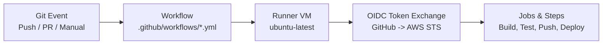

# GitHub Actions CI/CD Complete Guide: AWS eCommerce Platform

Welcome to your first GitHub Actions CI/CD setup! This guide explains everything you need to know about how your pipelines work under the hood, how AWS OpenID Connect (OIDC) authenticates without passwords, and the step-by-step instructions to run, test, and monitor them.

---

## 1. Core Concepts: The Mental Model

GitHub Actions is an **event-driven automation engine** hosted directly within GitHub.



### Key Terminology
1. **Workflow**: An automated configurable procedure defined in a `.yml` file under `.github/workflows/`.
2. **Event (`on:`)**: The trigger that tells GitHub when to run the workflow.
   - `push`: Whenever commits are pushed to the repository.
   - `pull_request`: When a Pull Request is opened or updated.
   - `workflow_dispatch`: Enables a manual **"Run workflow"** button in GitHub's web interface.
   - `paths:` **(Path Filtering)**: Only runs the workflow when specific folders change. For example, editing frontend CSS won't waste time rebuilding backend Docker images!
3. **Runner (`runs-on: ubuntu-latest`)**: A clean, isolated Virtual Machine in GitHub's cloud. Every run starts with a completely fresh Ubuntu machine.
4. **Permissions (`permissions:`)**: Controls the GitHub token capabilities. We set `id-token: write` so GitHub can generate secure cryptographic tokens for AWS OIDC.
5. **Job**: A sequence of steps executed on the same runner. Jobs can run in parallel (e.g. using a `matrix` strategy).
6. **Step**: An individual task. Can be an **Action** (reusable community plugin like `actions/checkout@v4`) or a **Run** command (shell script).

---

## 2. Why Zero-Secret OIDC? (No Passwords or API Keys)

Traditional CI/CD required generating static AWS IAM Access Keys (`AKIA...` and Secret Key) and storing them in GitHub Secrets.

> [!WARNING]
> **Risks of Static AWS Keys:**
> - Static keys never expire unless manually rotated.
> - If accidentally leaked in logs or public commits, attackers gain access to your AWS account.
> - Hard to audit which specific commit or pipeline used which key.

### The Modern Way: AWS OpenID Connect (OIDC)
Our setup uses **Zero-Secret OIDC**:
```
GitHub Actions Runner                      AWS IAM / STS
       |                                          |
       | 1. Generates signed JWT token            |
       |----------------------------------------->|
       |                                          | 2. Validates:
       |                                          |    - Issuer: token.actions.githubusercontent.com
       |                                          |    - Audience: sts.amazonaws.com
       |                                          |    - Subject: repo:mohsen2181/terraform-aws-projets:*
       |                                          |
       | 3. Returns temporary 15-min credentials |
       |<-----------------------------------------|
       |                                          |
(Uses temp keys for S3 / ECR / ECS commands)
```

No passwords or access keys are saved anywhere in GitHub Secrets.

---

## 3. Breakdown of Your 3 Workflows

### 🟢 1. Terraform CI (`terraform-ci.yml`)
- **Trigger**: Changes inside `terraform-ecommerce/environments/**` or `terraform-ecommerce/modules/**`.
- **Purpose**: Fast feedback loop ensuring Terraform code is properly formatted and syntactically valid before deployment.
- **Key Steps**:
  1. `actions/checkout@v4`: Downloads the repository code to the runner.
  2. `hashicorp/setup-terraform@v3`: Installs Terraform `1.8.5` on the runner.
  3. `terraform fmt -check -recursive`: Fails if code does not adhere to standard canonical formatting.
  4. **Dynamic Lambda Zip Packaging**: Terraform uses `filebase64sha256("...order_processor.zip")`. Because `.zip` files are gitignored, fresh GitHub runners don't have the zip. This step creates a dummy zip so validation passes cleanly without checking binaries into git.
  5. `terraform init -backend=false`: Initializes providers without requiring remote state backend access.
  6. `terraform validate`: Validates all module arguments, variable types, and resource syntax.

---

### 🟣 2. Frontend CI/CD (`frontend-ci.yml`)
- **Trigger**: Changes inside `terraform-ecommerce/frontend/**`.
- **Purpose**: Compiles the React SPA, uploads production assets to S3, and invalidates CloudFront edge caches.
- **Key Steps**:
  1. `actions/setup-node@v4`: Configures Node.js 18 and caches `~/.npm` dependencies.
  2. `npm ci`: Clean, deterministic installation of packages from `package-lock.json`.
  3. `npm run build`: Generates optimized static HTML, CSS, and JS bundles (with `CI: false` so warnings don't break production builds).
  4. `aws-actions/configure-aws-credentials@v4`: Authenticates to AWS via OIDC assuming role `github-actions-ecommerce-role`.
  5. `aws s3 sync ... --delete`: Uploads build assets to S3 bucket `ecommerce-frontend-assets-727742746869`.
  6. `aws cloudfront create-invalidation`: Flushes edge CDN caches globally so visitors instantly receive the latest updates.

---

### 🔵 3. Microservices CI/CD (`microservices-ci.yml`)
- **Trigger**: Changes inside `terraform-ecommerce/backend/**`.
- **Purpose**: Builds Docker images for all 4 microservices simultaneously, pushes them to Amazon ECR, and rolls out ECS updates.
- **The Matrix Strategy (`strategy.matrix`)**:
  Instead of writing 4 duplicate jobs, GitHub runs all 4 microservices **in parallel**:
  - `product-service` $\to$ `ecommerce/product-service`
  - `cart-service` $\to$ `ecommerce/cart-service`
  - `user-service` $\to$ `ecommerce/user-service`
  - `order-service` $\to$ `ecommerce/order-service`
- **Key Steps**:
  1. `aws-actions/configure-aws-credentials@v4`: Assumes the OIDC IAM Role.
  2. `aws-actions/amazon-ecr-login@v2`: Logs the runner Docker daemon into AWS ECR.
  3. `docker build`: Builds the microservice Docker image with two tags: `:latest` and `:${{ github.sha }}` (traceability to git commit).
  4. `docker push`: Pushes the images to private Amazon ECR repositories.
  5. `aws ecs update-service --force-new-deployment`: Signals AWS ECS Fargate to pull the new image and perform zero-downtime rolling replacement of container tasks.

---

## 4. Workflow Execution Order & Lifecycle Dependencies

Understanding the execution order of your workflows depends on whether you are deploying for the **first time (initial bootstrapping)** or performing **day-to-day feature development**:

### A. Initial Deployment Order (From Scratch)

When provisioning the eCommerce platform in a brand new AWS environment, the workflows follow a strict logical sequence:

```
┌─────────────────────────────────┐
│  1. Terraform CI & Apply        │  Provisions VPC, RDS, S3, CloudFront, ECR & ECS
└────────────────┬────────────────┘
                 │ (Infrastructure is now live)
                 ▼
┌─────────────────────────────────┐
│  2. Microservices CI/CD         │  Builds Docker images, pushes to ECR, rolls out ECS
└────────────────┬────────────────┘
                 │ (Backend APIs are live behind ALB)
                 ▼
┌─────────────────────────────────┐
│  3. Frontend CI/CD              │  Builds React SPA, syncs to S3, invalidates CloudFront
└─────────────────────────────────┘
```

1. **Step 1: Terraform CI & Provisioning (Infrastructure)**:
   - **Must run first**: Terraform creates the foundational resources—including the 4 Amazon ECR repositories (`ecommerce/product-service`, etc.), the ECS cluster, the S3 static hosting bucket (`ecommerce-frontend-assets-...`), and the CloudFront distribution.
   - If you run the frontend or microservices pipelines before Terraform finishes, they will fail because the destination S3 bucket or ECR repositories do not exist yet.
2. **Step 2: Microservices CI/CD (Backend APIs)**:
   - Builds the 4 microservices in parallel, pushes the Docker images to ECR, and triggers the ECS Fargate rolling deployment behind the Application Load Balancer.
3. **Step 3: Frontend CI/CD (Client SPA)**:
   - Compiles the React SPA, uploads static bundles to S3, and clears the CloudFront CDN cache. The frontend can now communicate with the healthy backend microservices.

---

### B. Day-to-Day Development Order (Path-Filtered & Independent)

Once the infrastructure is up, workflows run **independently and automatically** using Git path filters:

| Modified Path | Triggered Workflow | Behavior |
| :--- | :--- | :--- |
| `terraform-ecommerce/frontend/**` | **`Frontend CI/CD`** | Runs immediately (isolated from backend/Terraform) |
| `terraform-ecommerce/backend/**` | **`Microservices CI/CD`** | Runs immediately (builds 4 containers in parallel) |
| `terraform-ecommerce/modules/**` | **`Terraform CI`** | Runs immediately (validates syntax & format) |
| `terraform-ecommerce/docs/**` | *None* | Skipped (preserves CI runner minutes) |

> [!TIP]
> **Why independence is best practice for microservices**:
> A UI bug fix in React shouldn't have to wait 5 minutes for backend Docker containers or Terraform validation. Each component deploys as soon as its code changes.

---

### C. Manual Execution Order (Via GitHub UI)

If you use the manual **"Run workflow"** (`workflow_dispatch`) button from the GitHub Actions dashboard, run them in this order:
1. `Terraform CI`
2. `Microservices CI/CD`
3. `Frontend CI/CD`

---

## 5. Step-by-Step: How to Run the Workflows

You have two primary ways to run these workflows:

### Method A: Automatic Trigger via Git Push (Standard Development)

Whenever you edit files locally on your VM or computer and push to the `main` branch, GitHub Actions will inspect which files changed and trigger the corresponding pipeline automatically.

#### 1. Test the Frontend Pipeline
On your Vagrant VM:
```bash
cd /home/vagrant/terraform-projects/terraform-aws-projets

# 1. Make a small visual edit (e.g. in App.js or a comment)
echo "// Test update $(date)" >> terraform-ecommerce/frontend/react-app/src/index.js

# 2. Stage, commit, and push
git add terraform-ecommerce/frontend/react-app/src/index.js
git commit -m "test: update frontend application"
git push origin main
```
*Result: Only **Frontend CI/CD** will trigger!*

#### 2. Test the Microservices Pipeline
```bash
# 1. Edit a backend file
echo "# Test build $(date)" >> terraform-ecommerce/backend/product-service/README.md

# 2. Stage, commit, and push
git add terraform-ecommerce/backend/product-service/README.md
git commit -m "test: trigger microservices build"
git push origin main
```
*Result: Only **Microservices CI/CD** will trigger, spinning up 4 parallel Docker builders.*

#### 3. Test the Terraform Pipeline
```bash
# 1. Edit a Terraform comment or variable description
echo "# Validated on $(date)" >> terraform-ecommerce/environments/dev/main.tf

# 2. Stage, commit, and push
git add terraform-ecommerce/environments/dev/main.tf
git commit -m "test: trigger terraform validation"
git push origin main
```
*Result: Only **Terraform CI** will trigger.*

---

### Method B: Manual Trigger from GitHub Web UI (`workflow_dispatch`)

You can run any workflow on demand without making any code changes:

1. Open your browser and navigate to:
   👉 **`https://github.com/mohsen2181/terraform-aws-projets/actions`**
2. In the left sidebar, click the workflow you want to run (e.g., **"Microservices CI/CD"** or **"Frontend CI/CD"**).
3. Look for the blue notice bar on the right side: **"Run workflow"** dropdown button.
4. Click **"Run workflow"**, ensure **Branch: main** is selected, and click the green **"Run workflow"** button.
5. Within 3-5 seconds, a new run will appear at the top of the list.

---

## 6. How to View Logs and Monitor Executions

1. Go to the **Actions** tab on GitHub:
   `https://github.com/mohsen2181/terraform-aws-projets/actions`
2. Click on any workflow run (e.g., *ci_test_microservices_build*).
3. Click on the specific job box (e.g. *Build & Push Microservices (product-service)*).
4. You will see a live console streaming every command output in real time.
5. Click on any step (such as **"Build, Tag, and Push Docker Image"**) to expand stdout logs, check image hashes, or inspect warnings.

---

## 7. Summary Checklist

- [x] **Zero secrets stored**: AWS OIDC IAM Role configured with scoped trust policy.
- [x] **Path filtering active**: Pipelines only run when relevant directories are modified.
- [x] **Parallel builds**: Microservices matrix runs 4 container builds simultaneously.
- [x] **Automatic rolling deployment**: Pushing container images automatically signals ECS Fargate.
- [x] **Edge cache invalidation**: React builds immediately purge CloudFront caches.
